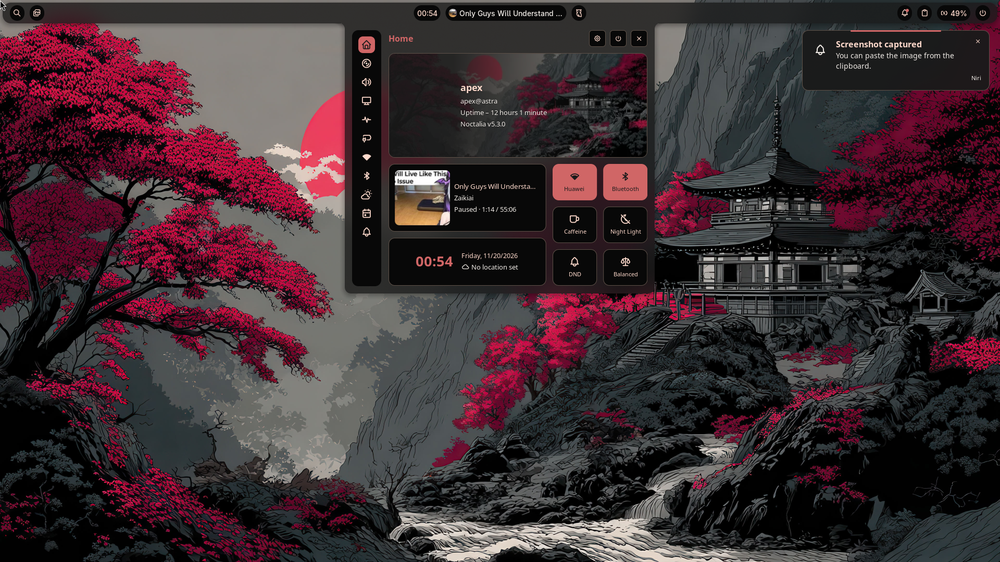
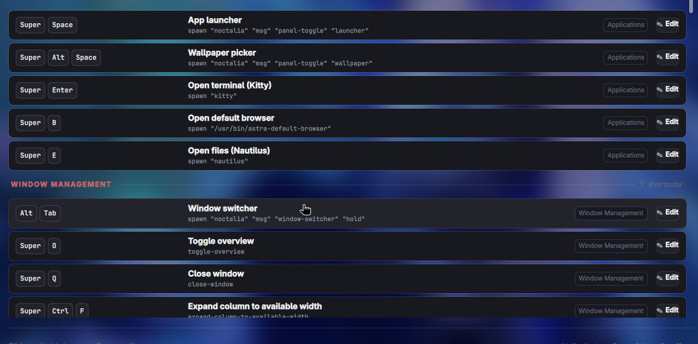

<div align="center">

# ✦ Eva Linux v2 Stable

**A script-based desktop setup installer transforming Arch Linux into an elegant, high-performance Wayland environment.**

[](LICENSE)
[](https://archlinux.org)
[](https://github.com/YaLixDee/niri)
[](https://github.com/noctalia-dev/noctalia)

<br/>



</div>

---

## ✦ Overview

**Eva Linux is NOT an ISO.** It is a modular, idempotent, and script-based desktop setup installer.

Eva Linux transforms any compatible, minimal or existing **Arch Linux** installation into a cohesive, developer-grade desktop featuring:
- **Niri Compositor:** An infinite, scrollable-tiling Wayland window manager built with smooth physics and zero screen tearing.
- **Noctalia 5 Shell:** A modern QML desktop shell providing an interactive capsule top bar, system control center, and dynamic theming.
- **Interactive Keybind Overlay:** A native Wayland cheatsheet and live shortcut editor (`Super + Shift + /`) with real-time conflict detection and sandbox validation.
- **Kitty Terminal & LazyVim:** GPU-accelerated terminal paired with a full-featured Neovim development environment.
- **Pure Upstream Theming:** Upstream [SilentSDDM](https://github.com/uiriansan/SilentSDDM) login greeter and [HyperFluent](https://github.com/Coopydood/HyperFluent-GRUB-Theme) GRUB bootloader theme, customized exclusively with background wallpaper synchronization.
- **Automated Wallpaper Synchronization:** Changing your desktop wallpaper in Noctalia automatically updates your SDDM login screen and GRUB bootloader background safely without running `grub-mkconfig`.

---

## ✦ Key Features

### 1. Scrollable Tiling with Niri
- **Dynamic Columns:** Infinite horizontal desktop scrolling with column width presets (`33%`, `50%`, `66%`).
- **Hardware-Accelerated Blur:** Frosted glass blur behind overlays, popups, and floating windows.
- **Multi-Monitor:** Seamless workspace handling across multi-monitor setups.

### 2. Noctalia 5 Desktop Shell
- **Capsule Top Bar:** Clean top bar displaying launcher, wallpaper selector, active window title, clock, media widgets, and hardware stats.
- **Control Center:** Unified panel for Wi-Fi, Bluetooth, Audio sinks, Night Light, Caffeine, and power modes.
- **Material You / Community Themes:** Automated color scheme generation based on your active wallpaper.

### 3. Native Keybind Cheatsheet & Live Editor
<div align="center">
  
</div>

- **Shortcut:** Press `Super + Shift + /` anytime to toggle the cheatsheet overlay.
- **Search:** Instant fuzzy filtering by key name, category, or command.
- **Interactive Editing:** Click "Edit", press your desired shortcut on your keyboard, resolve conflicts (Replace or Swap), and apply changes live. The editor runs `niri validate` in a sandbox before saving to `~/.config/niri/keybinds.kdl`, automatically rolling back on error.

### 4. Zero-Risk Wallpaper Synchronization
- Changing wallpaper via `Super + Alt + Space` or `noctalia msg wallpaper-set` triggers `eva-wallpaper-sync`.
- **SilentSDDM:** Updates `/usr/share/sddm/themes/silent/backgrounds/eva-wallpaper.jpg`. Theme layout, fonts, and controls remain 100% upstream-identical.
- **HyperFluent GRUB:** Converts wallpaper to boot-accessible PNG at `/boot/grub/themes/hyperfluent/background.png`. **`grub-mkconfig` is never executed during wallpaper sync**, eliminating any risk of breaking boot entries.

### 5. Robust Backup & Restoration
- Creates a timestamped snapshot of all existing configs in `~/eva_backups/backup_YYYYMMDD_HHMMSS/` with a manifest.
- Run `eva-restore` at any time to selectively roll back your desktop configuration.

---

## ✦ Installation

### Requirements
- **Operating System:** Arch Linux or Arch-based distribution (rolling release).
- **Architecture:** `x86_64`.
- **Permissions:** Standard user with `sudo` privileges.
- **Connectivity:** Active internet connection.

### Method 1: Quick Bootstrap (One Command)
Run the bootstrap installer in your terminal:

```bash
curl -fsSL https://raw.githubusercontent.com/AmanicX/eva-linux/main/install.sh | bash
```

### Method 2: Manual Git Installation
Clone the repository and run the setup script:

```bash
git clone https://github.com/AmanicX/eva-linux.git
cd eva-linux
chmod +x setup.sh
./setup.sh
```

### Installer CLI Options
```bash
./setup.sh --help

Options:
  -y, --yes          Non-interactive mode (use recommended defaults for all prompts)
  --skip-update      Skip system update (pacman -Syu)
  --skip-backup      Skip configuration backup step
  -h, --help         Display usage information
```

---

## ✦ Core Default Keybindings

| Shortcut | Action | Description |
|---|---|---|
| `Super + Shift + /` | **Keybind Cheatsheet** | Open the interactive shortcut overlay |
| `Super + Space` | **App Launcher** | Toggle Noctalia application menu |
| `Super + Alt + Space` | **Wallpaper Picker** | Open Noctalia wallpaper selector |
| `Super + Enter` | **Terminal** | Open Kitty GPU-accelerated terminal |
| `Super + B` | **Web Browser** | Launch default browser |
| `Super + E` | **File Manager** | Open Nautilus |
| `Super + Q` | **Close Window** | Close the currently focused window |
| `Super + F` | **Fullscreen** | Toggle window fullscreen mode |
| `Super + Shift + F` | **Floating** | Toggle floating / tiling layout |
| `Alt + Tab` | **Window Switcher** | Open Wayland window switcher |
| `Print` | **Screenshot (Region)** | Interactive region selection screenshot |
| `Ctrl + Print` | **Screenshot (Full)** | Capture entire screen to `~/Pictures/Screenshots` |
| `Alt + Print` | **Screenshot (Window)** | Capture active window |
| `Super + 1–9` | **Workspaces** | Switch to workspace 1 through 9 |
| `Super + Shift + 1–9` | **Move Window** | Move column to workspace 1 through 9 |

---

## ✦ Optional Components

- **Eva Advanced AI Chatbot:** Multi-theme, memory-aware AI character and world chat studio. Can be installed during setup or skipped.
- **Browser Selection:** Choose between Firefox, Zen Browser, Brave, Chromium, Google Chrome, or Vivaldi during setup.
- **AUR Helper:** Automatic detection and selection between `yay` and `paru`.

---

## ✦ Upstream Attribution & Credits

Eva Linux is built upon exceptional projects by the open-source community:

- **[Niri](https://github.com/YaLixDee/niri)** by YaLixDee — Scrollable tiling Wayland compositor (GPL-3.0-or-later)
- **[Noctalia](https://github.com/noctalia-dev/noctalia)** by Clement Fombonne & team — Desktop shell environment (MIT)
- **[Quickshell](https://github.com/outfoxxed/quickshell)** by outfoxxed — Native Wayland QML toolkit (LGPL-3.0-only)
- **[SilentSDDM](https://github.com/uiriansan/SilentSDDM)** by uiriansan — Minimalist SDDM greeter (GPL-3.0-only)
- **[HyperFluent GRUB Theme](https://github.com/Coopydood/HyperFluent-GRUB-Theme)** by Coopydood — Modern GRUB theme (MIT)
- **[Kitty](https://github.com/kovidgoyal/kitty)** by Kovid Goyal — Fast GPU terminal (GPL-3.0-only)
- **[LazyVim](https://github.com/LazyVim/LazyVim)** by folke — Modular Neovim configuration (Apache-2.0)

---

## ✦ License

This project is licensed under the [MIT License](LICENSE).
Third-party themes and components retain their respective upstream licenses. See [CREDITS.md](CREDITS.md) for full details.
